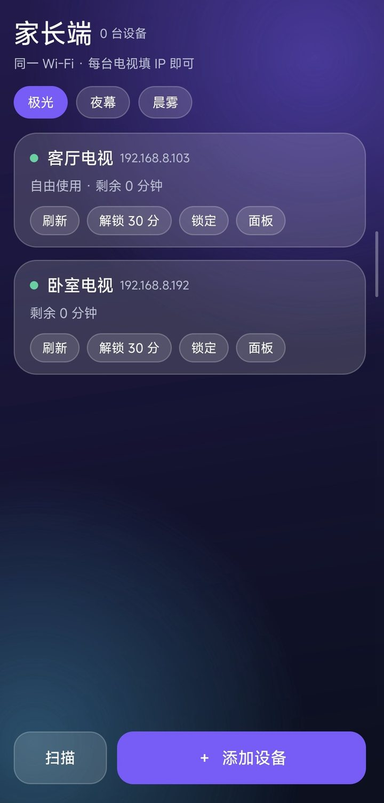
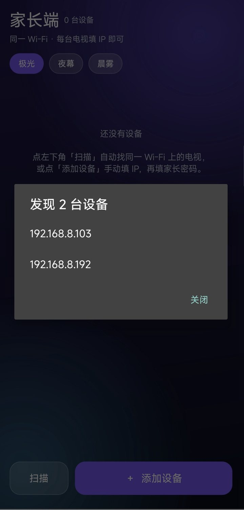
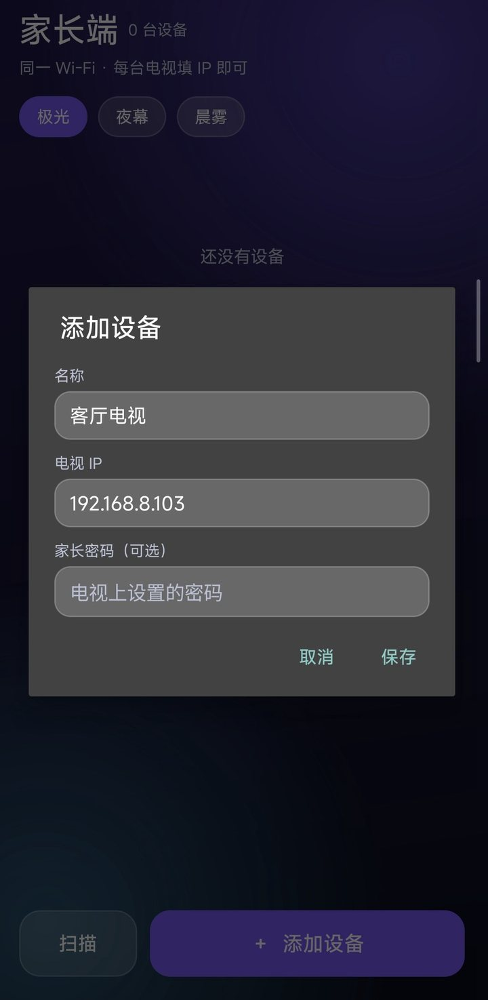
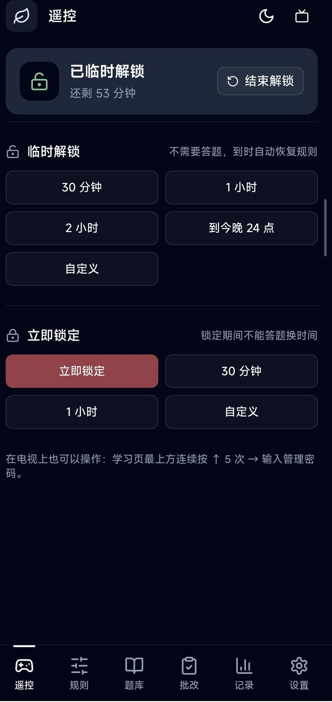

<div align="center">


# 家长端 · Parent Console

**多台电视，一个手机管完。**

[StudyOnTV（题了个题）](https://github.com/chadyi/StudyOnTV) 的第三方家长控制端：把局域网里每台电视 / 平板的家长面板收进一个 App，
填 IP + 密码就能直接进控制页，不用记端口、不用每次重新登录。

Android 5.0+ · 零第三方依赖 · MIT

</div>

---

## 为什么需要它

StudyOnTV 的家长面板由**被控设备自己**在 `:8099` 上提供。管理两台以上电视时，你会遇到这些麻烦：

- 每台设备的地址都是 `http://<IP>:8099/admin/`，端口和路径要自己拼；
- 每换一台设备就要重新输一次管理密码；
- 在手机浏览器里开一堆标签页，分不清哪个是客厅、哪个是卧室。

「家长端」把地址拼接、密码登录、面板会话全部内置：**只填 IP 和家长密码，保存后直接落在控制页**。

## 截图

<div align="center">

<table>
<tr>
<td align="center" width="50%">
<br>
<sub><b>设备列表</b> · 多台电视、在线状态、快捷解锁/锁定</sub>
</td>
<td align="center" width="50%">
<br>
<sub><b>自动发现</b> · 扫描同一 Wi-Fi，列出装了 StudyOnTV 的电视</sub>
</td>
</tr>
<tr>
<td align="center" width="50%">
<br>
<sub><b>添加设备</b> · 只填 IP 和家长密码，端口路径都内置</sub>
</td>
<td align="center" width="50%">
<br>
<sub><b>控制页</b> · 点卡片直达设备自己的家长面板，无需二次登录</sub>
</td>
</tr>
</table>

</div>

## 功能

- **自动发现**：点一下「扫描」，自动列出同一 Wi-Fi 上装了 StudyOnTV 的电视，选一台填密码即可添加。
- **多设备管理**：设备卡片列表，名称 / IP / 在线状态一目了然，支持编辑、删除。
- **只填 IP**：`:8099/admin/` 完全内置，粘贴完整 URL 也会自动剥成 IP。
- **免二次登录**：打开面板时自动注入面板自身的会话（`localStorage["sotv-panel-session"]`），不再停在「验证并连接」。
  会话失效时会自动把密码填好，点一下即可。
- **快捷操作**：卡片上直接「刷新 / 解锁 30 分 / 锁定」，不用进面板。
- **批量操作**：列表顶部一键「全部刷新 / 全部锁定 / 全部解锁 30 分」，多台电视一次处理。
- **上次在线**：离线设备显示最后一次连上的时间，不用猜是不是关机了。
- **返回即回列表**：在控制页用手势或返回键，直接回到设备列表，不会在网页历史里一层层退。
- **毛玻璃界面 + 3 套主题**：极光（默认）、夜幕、晨雾，选择会记住。
- **零依赖**：纯 `android.webkit` + `HttpURLConnection`，APK 不到 500 KB。
- **附带网页版**：同一套界面，浏览器打开即用，不想装 APK 时可以用。

## 下载安装

**[⬇ parent-console-v0.3.2.apk](releases/parent-console-v0.3.2.apk)**（约 480 KB，已签名）
直达链接：<https://github.com/huli2008/parent-console/raw/main/releases/parent-console-v0.3.2.apk>

传到手机安装（自签名，安装时选择「仍要安装」）。已装旧版的可以直接覆盖升级（同一签名）。

首次打开：点「扫描」自动发现设备，或点「添加设备」手动填 IP（例如 `192.168.8.192`）和家长密码 → 「保存并进入」。

> 历史版本仍保留在 `releases/` 目录。
> v0.3.0 局域网自动发现 · v0.3.1 修正顶部设备计数 · v0.3.2 批量操作、上次在线、返回直接回列表。

> 手机与电视必须在**同一个 Wi-Fi**。被控设备需要先装好 StudyOnTV，并在首次使用时设置过家长密码。

## 网页版

```bash
cd www
python -m http.server 8080 --bind 0.0.0.0
# 手机浏览器打开 http://<电脑IP>:8080/
```

## 它怎么和 StudyOnTV 通信

被控设备在局域网 `:8099` 提供 HTTP 接口（CORS 为 `*`，鉴权用 `Authorization: Bearer <token>`）：

| 接口 | 用途 |
|---|---|
| `POST /api/auth` `{passphrase, remember}` | 用家长密码换 token（连续错 5 次锁 1 分钟） |
| `GET /api/state` | 学习状态：`learning.mode`（unlock/lock）、`learning.remainingSeconds`、`learning.free` |
| `POST /api/remote` `{action, minutes}` | `unlock` / `lock` / `pause` |
| `/admin/` | 设备自带的完整管理面板（React SPA） |

面板把会话存在 `localStorage` 的 `sotv-panel-session`（`{host, token}`），启动时读不到就显示登录页。
家长端在 WebView 首次加载 `/admin/` 时拦截请求，返回一段同源 HTML 写入该键再跳转，因此**打开即是控制页**。

## 从源码构建

需要 JDK 17 和 Android SDK 的 `build-tools` + `platform`（不需要 Gradle）：

```powershell
powershell -ExecutionPolicy Bypass -File android\build-apk.ps1 `
  -JavaHome   'C:\jdk-17' `
  -BuildTools 'C:\android-sdk\build-tools\34.0.0' `
  -Platform   'C:\android-sdk\platforms\android-33\android.jar'
```

产物在 `dist/parent-console.apk`。脚本流程：`aapt2 compile/link` → `javac` → `d8` → `zip` → `zipalign` → `apksigner`，
首次运行会生成 `android/keystore.jks`（自签名，请自行保管，勿提交）。

也可以用 Gradle：`cd android && gradle assembleRelease`。

## 目录结构

```
android/
  build-apk.ps1                  # 无 Gradle 构建脚本
  app/src/main/AndroidManifest.xml
  app/src/main/java/com/parent/console/
    MainActivity.java            # 设备列表、主题、增删改
    WebActivity.java             # 内嵌面板 + 会话注入
    Api.java                     # 登录 / 状态 / 远程控制
    Theme.java                   # 三套主题配色
    Backdrop.java                # 渐变 + 光晕背景
    Device.java / Store.java     # 模型与持久化
  app/src/main/res/mipmap-*/     # 启动图标（自适应 + 圆形）
www/index.html                   # 单文件网页版
assets/                          # 图标源文件与生成脚本
```

## 已知限制

- 界面在 Android 12 手机尺寸上开发，**尚未在真机逐项回归**；不同厂商的 WebView 可能表现略有差异。
- 明文 HTTP，仅限家庭局域网使用；不要在公网暴露 `:8099`。
- 面板的会话键若随 StudyOnTV 版本变化，自动登录会退化为「密码已填好、点一下进入」。

## 免责声明

本项目是 StudyOnTV 的**非官方**配套工具，与 StudyOnTV 作者无关，也未与其代码产生耦合（仅调用其公开的局域网接口）。
请仅用于自己家庭的设备。

## License

[MIT](LICENSE)
